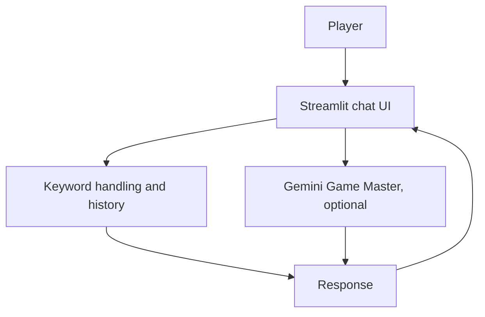
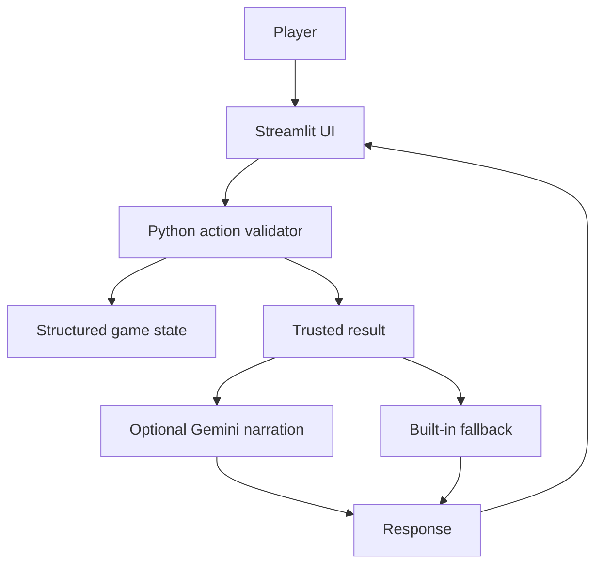

# AI Escape Room — Version 1 and Version 2

A small Python escape-room game. Explore a locked library, discover clues, open a drawer, and unlock the exit.

## Goals
- **Version 1:** Natural-language chat and an LLM Game Master.
- **Version 2:** Python validates actions and stores game state; the LLM only narrates trusted results.

## Technologies
Python, Streamlit, Google Gemini API (optional at runtime), Python dictionaries, pytest.

## Setup
Python 3.10+ recommended.

```bash
python -m venv .venv
```
Activate it: macOS/Linux `source .venv/bin/activate`; Windows PowerShell `.venv\Scripts\Activate.ps1`.

```bash
pip install -r requirements.txt
```

Optional Gemini setup: copy `.env.example` to `.env`, then add your own API key. Never upload `.env` to GitHub. API availability and free-tier limits can change. Both apps have a built-in fallback if no key is set.

## Run the apps

```bash
streamlit run app_v1.py
```

```bash
streamlit run app_v2.py
```

## Example Version 2 path
1. `Examine the bookshelf`
2. `Open drawer with code 246`
3. `Examine the painting`
4. `Unlock door with code 7314`

## Run tests

```bash
pytest -q
```

Tests cover restart, wrong codes, false claims, missing clues, administrator-style prompts, and a valid escape path. Also manually test the apps and record real results before submission.

## Architecture
### Version 1

### Version 2


## Limitations
The action parser recognises common English phrases, not every possible sentence. Version 1 is a baseline and is not a secure game engine. Version 2 reduces the risk of the LLM changing rules because Python controls state, but it is not a complete security system. Internet and a valid key are required for Gemini narration.

